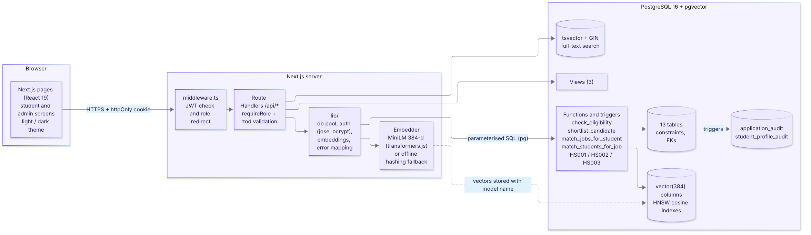
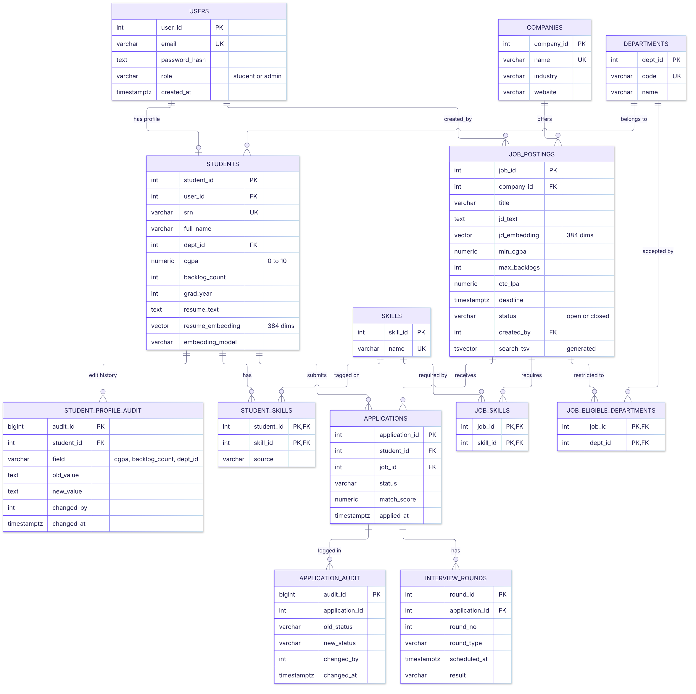
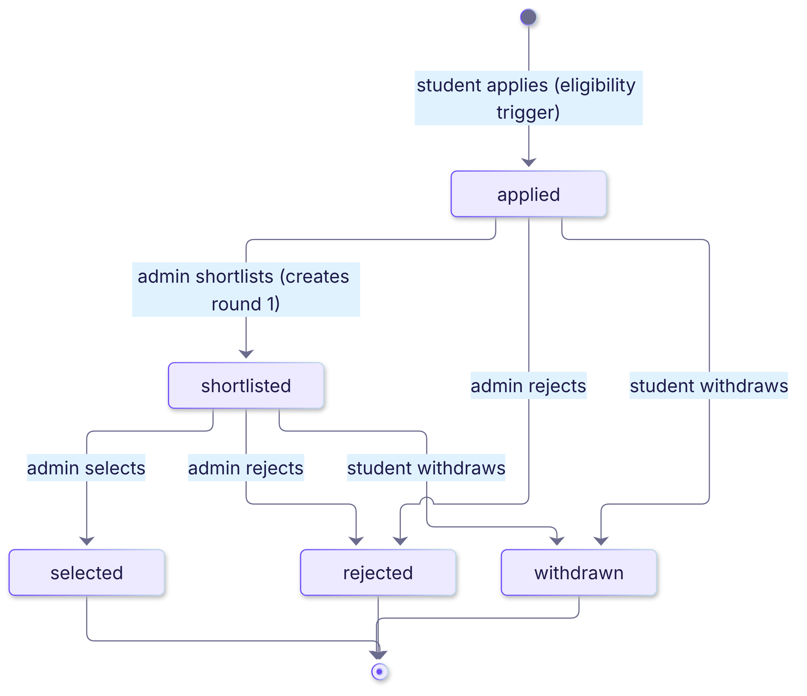
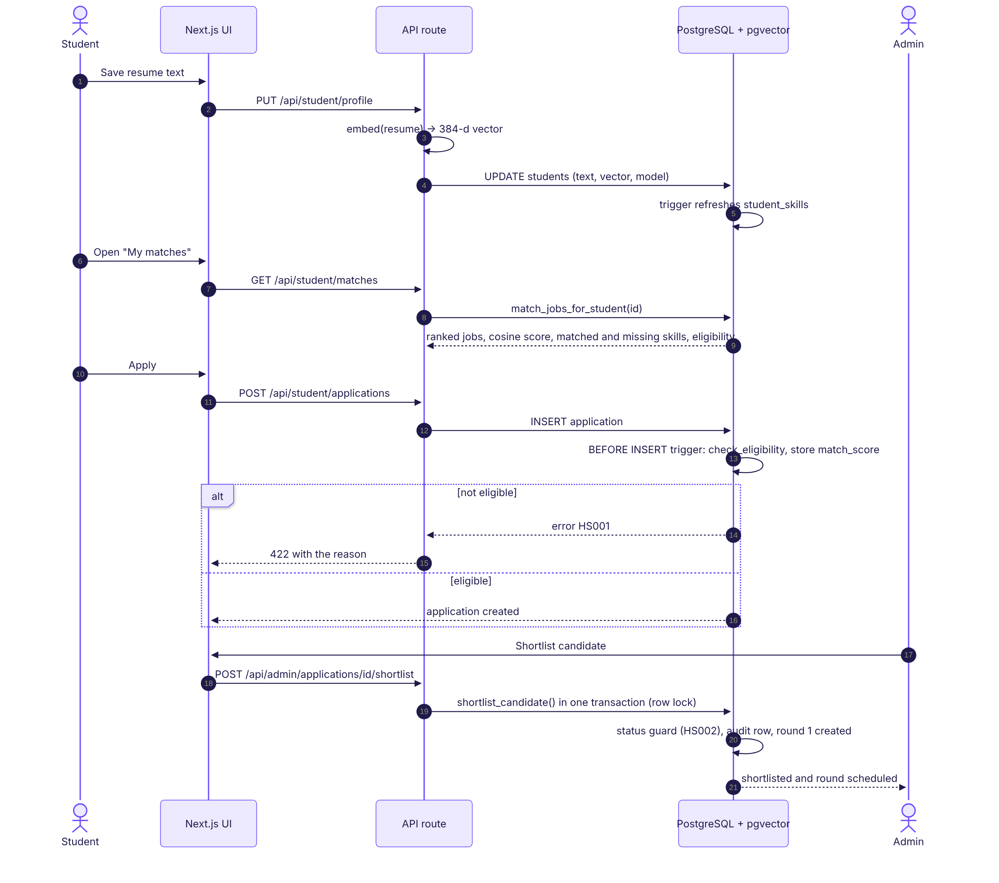
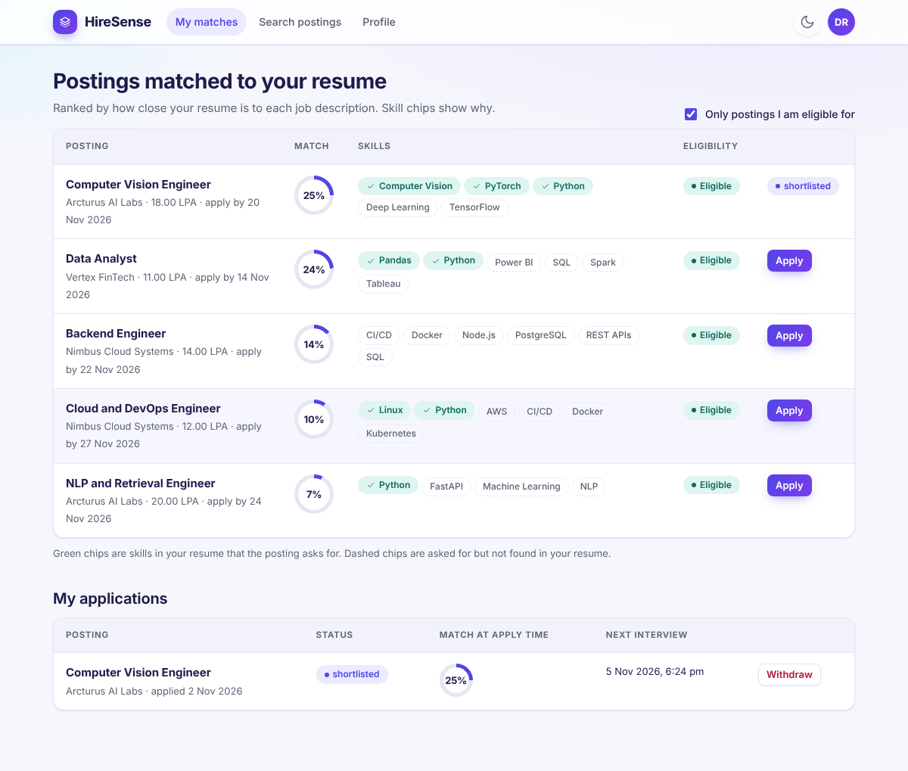
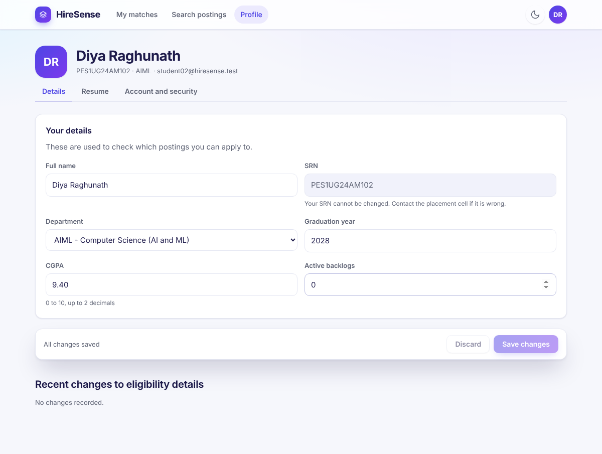
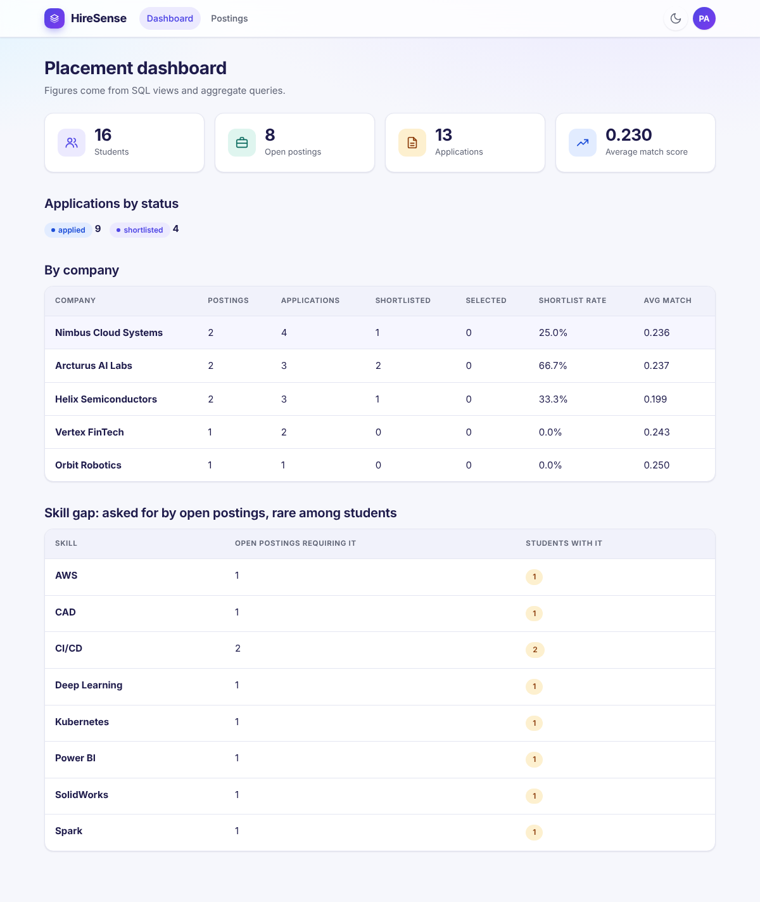
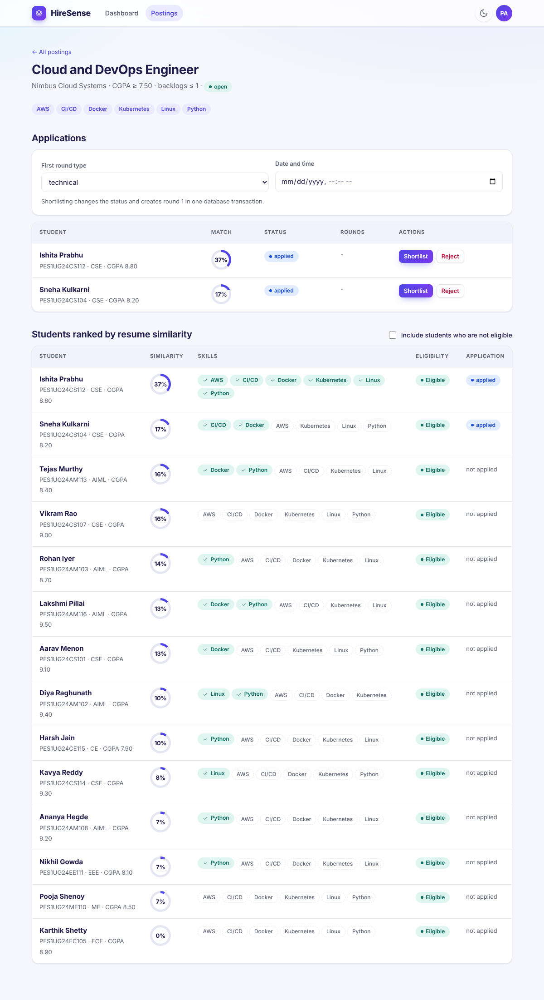
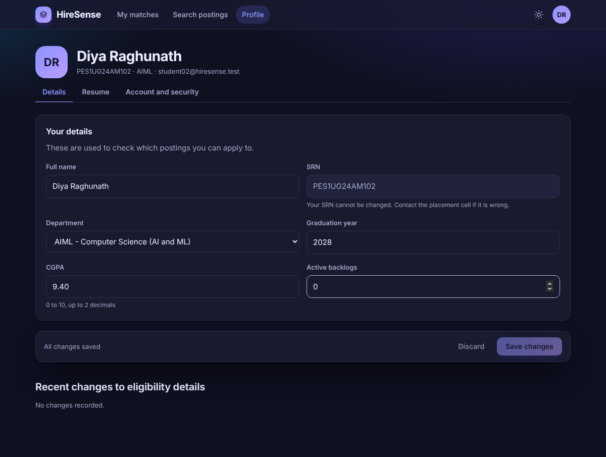
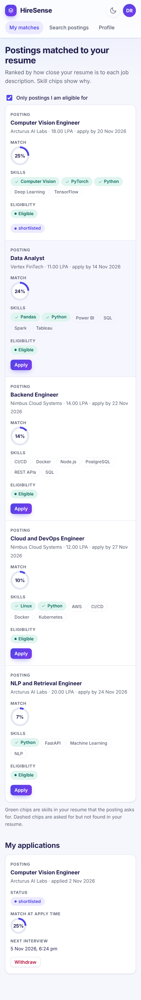

# HireSense

**Explainable skill-matching platform for campus recruitment.** DBMS Level 3 Experiential Learning project, PES University.

Students paste a resume, placement admins post jobs, and the database ranks one against the other by
vector similarity (PostgreSQL + pgvector). Every match is explained: the UI shows which required skills the
resume contains and which are missing. Eligibility rules (CGPA, backlogs, department, deadline) and the
application lifecycle are enforced **inside the database** by functions and triggers, so no client can bypass them.



## Contents

1. [Features](#features)
2. [Architecture](#architecture)
3. [ER diagram](#er-diagram)
4. [Relational schema and data dictionary](#relational-schema-and-data-dictionary)
5. [Database design: what lives where and why](#database-design-what-lives-where-and-why)
6. [How a request flows](#how-a-request-flows)
7. [API reference](#api-reference)
8. [Setup](#setup)
9. [Tests](#tests)
10. [Screenshots](#screenshots)
11. [Where each course requirement lives](#where-each-course-requirement-lives)
12. [Embeddings: read this before you demo](#embeddings-read-this-before-you-demo)
13. [Security notes](#security-notes) and [Known limits](#known-limits)
14. [Project layout](#project-layout)

## Features

**Student**
- Register and log in; paste a resume; see postings ranked by cosine similarity with matched and missing skill chips.
- Search postings with full-text search; apply (the database rejects ineligible applications and says why); withdraw.
- Track applications, match score at apply time and next interview.
- **Profile page** (`/student/profile`): edit name, department, CGPA, backlogs and graduation year; manage the resume; change email and password. SRN and role cannot be changed.

**Admin (placement cell)**
- Dashboard (totals, applications by status, per-company placement summary, skills employers want that few students have).
- Create postings with required skills and eligible departments; open or close them.
- See students ranked against a posting by resume similarity, with eligibility reasons.
- Shortlist (creates round 1 in one transaction), record round results, select or reject.
- A **"profile edited"** badge shows when a student changed CGPA, backlogs or department, with old and new values.

**Platform**
- Two roles (student, admin) checked in middleware and again in every API route.
- Light theme by default with a dark toggle, responsive down to phone width.

## Stack

| Layer | Choice |
|---|---|
| Web UI and API | Next.js 15 (App Router, Route Handlers), React 19, TypeScript 5.9, plain CSS design system |
| SQL database | PostgreSQL 16 |
| Vector database | pgvector (`vector(384)` columns, HNSW indexes, cosine distance) |
| Validation | zod 4 at the API edge; CHECK constraints and triggers in the database |
| Auth | bcrypt password hashes, signed JWT (jose) in an httpOnly cookie |
| Embeddings | `Xenova/all-MiniLM-L6-v2` (384 dims) through transformers.js, with an offline fallback |

## Architecture

Source: `docs/diagrams/arch.mmd`.


| Layer | Responsibility |
|---|---|
| Browser | Next.js pages for students and admins. Calls `/api/*` with the session cookie. |
| `middleware.ts` | Verifies the JWT for `/student/*` and `/admin/*` and redirects the wrong role. |
| Route handlers (`app/api`) | `requireRole`, zod validation, then one parameterised SQL call. Database errors are mapped to HTTP codes (`HS001` to 422, `HS002` to 409, `HS003` to 404, unique violation to 409). |
| `lib/` | `db.ts` connection pool and `withTransaction`; `auth.ts` JWT; `embeddings.ts`; `api.ts` helpers; `http.ts` client fetch wrapper. |
| PostgreSQL | Source of truth and rule engine: constraints, triggers, matching functions, views, audit tables. |

Design rule: **business rules live in the database, the API is a thin layer**. The same eligibility function is used by the
insert trigger, the matching functions and the admin candidate list, so the three can never disagree.

## ER diagram

Source: `docs/diagrams/er.mmd` (also rendered as Mermaid in `docs/er-diagram.md`).



**Relationships in words**
- A `user` has at most one `student` profile; admins have none. A `user` may create many postings.
- A `department` has many students; a posting is restricted to departments through `job_eligible_departments` (no rows = all departments).
- `students` and `skills` are many-to-many through `student_skills`; `job_postings` and `skills` through `job_skills`.
- `students` and `job_postings` are many-to-many through `applications` (one application per pair, enforced by a UNIQUE constraint).
- An application has many `interview_rounds` and many `application_audit` rows; a student has many `student_profile_audit` rows.

## Relational schema and data dictionary

13 tables, all in `db/01_schema.sql` except `student_profile_audit` (`db/07_profile_audit.sql`). PK = primary key, FK = foreign key, UK = unique.

| Table | Columns (key and rules) |
|---|---|
| `departments` | `dept_id` PK, `code` UK, `name` |
| `users` | `user_id` PK, `email` UK (regex CHECK), `password_hash`, `role` CHECK in (student, admin), `created_at` |
| `students` | `student_id` PK, `user_id` FK UK (cascade), `srn` UK (regex CHECK `PES1UG24AM102` style), `full_name` (non-blank), `dept_id` FK, `cgpa` NUMERIC(4,2) CHECK 0 to 10, `backlog_count` CHECK >= 0, `grad_year` CHECK 2024 to 2035, `resume_text`, `resume_embedding` vector(384), `embedding_model`, `resume_updated_at` |
| `companies` | `company_id` PK, `name` UK, `industry`, `website` |
| `job_postings` | `job_id` PK, `company_id` FK, `title`, `jd_text`, `jd_embedding` vector(384), `embedding_model`, `min_cgpa` CHECK 0 to 10, `max_backlogs` CHECK >= 0, `ctc_lpa` CHECK > 0, `deadline`, `status` CHECK open/closed, `created_by` FK (set null), `search_tsv` generated tsvector |
| `job_eligible_departments` | PK (`job_id`, `dept_id`), both FK cascade |
| `skills` | `skill_id` PK, `name` UK (about 44 entries) |
| `student_skills` | PK (`student_id`, `skill_id`), `source` CHECK resume/manual |
| `job_skills` | PK (`job_id`, `skill_id`) |
| `applications` | `application_id` PK, `student_id` FK, `job_id` FK, `status` CHECK (applied, shortlisted, rejected, selected, withdrawn), `match_score` CHECK -1 to 1, `applied_at`, `updated_at`, UNIQUE (`student_id`, `job_id`) |
| `interview_rounds` | `round_id` PK, `application_id` FK, `round_no` CHECK >= 1, `round_type` CHECK (aptitude, technical, hr, group), `scheduled_at`, `result` CHECK (pending, pass, fail); UNIQUE (`application_id`, `round_no`); added by ALTER: a result needs a scheduled time |
| `application_audit` | `audit_id` PK, `application_id` (no FK on purpose, history outlives deletes), `old_status`, `new_status`, `changed_by`, `changed_at` |
| `student_profile_audit` | `audit_id` PK, `student_id` FK (cascade), `field` CHECK (cgpa, backlog_count, dept_id), `old_value`, `new_value`, `changed_by`, `changed_at` |

## Database design: what lives where and why

**Why two kinds of data in one database.** Relational data (students, jobs, applications) needs constraints, joins and
transactions. Semantic matching needs nearest-neighbour search over embeddings. pgvector gives both in PostgreSQL, so a
single query can filter by eligibility and rank by similarity without syncing a separate vector store.

**Advanced SQL concepts used**

| Concept | Where |
|---|---|
| Vector similarity search (`<=>` cosine) | `match_jobs_for_student`, `match_students_for_job` |
| Triggers | `application_before_insert` (HS001 eligibility + stores match score), `application_status_guard` (HS002 legal transitions), `application_audit`, `student_resume_changed` / `student_resume_stamp`, `student_profile_audit` |
| Stored functions | `check_eligibility`, `refresh_student_skills`, `shortlist_candidate`, the two matching functions |
| Transaction with row locking | `shortlist_candidate` (`SELECT ... FOR UPDATE`, status change + round 1 insert atomically) |
| Views (3) | `v_job_eligible_students`, `v_company_placement_summary`, `v_student_applications` |
| Indexing | B-tree composite, partial (`WHERE status = 'open'`), GIN (full text), HNSW (vectors) |
| Full-text search | generated `search_tsv` column + GIN, used by `GET /api/jobs?q=` |
| Joins, GROUP BY, HAVING, subqueries | `db/06_queries.sql`, admin dashboard route |
| Audit via session setting | `set_config('hiresense.actor', user_id, true)` so triggers record who acted |

**Application status lifecycle** (enforced by `application_status_guard`; anything else raises `HS002`)



**Error codes raised by the database**

| Code | Meaning | HTTP |
|---|---|---|
| `HS001` | Student not eligible (CGPA, backlogs, department, deadline or closed posting); message gives the reason | 422 |
| `HS002` | Illegal status transition | 409 |
| `HS003` | Record not found inside a function | 404 |

## How a request flows

Resume to match to apply to shortlist, end to end. Source: `docs/diagrams/flow.mmd`.



## API reference

All routes return JSON. Validation errors return `422 { error, fields }` where `fields` maps each input to its message.
"Student" and "Admin" mean the role required; the session cookie is `hs_session`.

| Method and path | Role | Purpose |
|---|---|---|
| `POST /api/auth/register` | public | Create user + student profile |
| `POST /api/auth/login` | public | Verify password, set session cookie |
| `POST /api/auth/logout` | any | Clear cookie |
| `GET /api/departments` | public | Department list for forms |
| `GET /api/jobs?q=` | any | Open postings, optional full-text search |
| `GET /api/student/profile` | Student | Profile, skills, recent eligibility changes |
| `PUT /api/student/profile` | Student | Save resume (re-embeds, re-tags skills) |
| `PATCH /api/student/profile/details` | Student | Edit name, department, CGPA, backlogs, grad year (strict schema, audited) |
| `POST /api/student/password` | Student | Change password (needs current password) |
| `POST /api/student/email` | Student | Change email (needs password; 409 if taken) |
| `GET /api/student/matches` | Student | Ranked postings with matched and missing skills |
| `GET /api/student/applications` | Student | My applications |
| `POST /api/student/applications` | Student | Apply (eligibility trigger runs) |
| `DELETE /api/student/applications/:id` | Student | Withdraw |
| `GET /api/admin/dashboard` | Admin | Aggregates |
| `GET, POST /api/admin/jobs` | Admin | List and create postings |
| `PATCH /api/admin/jobs/:id` | Admin | Open or close a posting |
| `GET /api/admin/jobs/:id/candidates` | Admin | Students ranked by similarity (`?all=1` includes ineligible) |
| `GET /api/admin/jobs/:id/applications` | Admin | Applications with rounds and profile changes |
| `POST /api/admin/applications/:id/shortlist` | Admin | Shortlist + schedule round 1 (transaction) |
| `POST /api/admin/applications/:id/decision` | Admin | Select or reject |
| `PATCH /api/admin/rounds/:id` | Admin | Record pass or fail |
| `GET /api/admin/skills` | Admin | Skill dictionary |

## Setup

Requirements: Node 20+ (22 recommended), PostgreSQL 14+ with the `pgvector` extension installed.

```bash
# 1. database (once)
createuser hiresense --pwprompt --createdb
createdb hiresense -O hiresense
# pgvector must be installed on the server, e.g.  sudo apt install postgresql-16-pgvector
# (or Docker: docker run -e POSTGRES_PASSWORD=pw -p 5432:5432 pgvector/pgvector:pg16)

# 2. app
npm install
cp .env.example .env.local        # then edit DATABASE_URL and JWT_SECRET
npm run db:setup                  # schema, triggers, views, audit table, sample data, embeddings, sample applications
npm run dev                       # http://localhost:3000
```

Environment variables (`.env.local`, never committed):

| Variable | Meaning |
|---|---|
| `DATABASE_URL` | PostgreSQL connection string |
| `JWT_SECRET` | 32+ random characters; the app refuses to start sessions without it |
| `EMBEDDING_PROVIDER` | `auto` (MiniLM, fall back to hashing), `transformers` (MiniLM only), `hash` (offline only) |

`db:setup` drops and recreates all HireSense tables. The first run downloads the MiniLM model (about 23 MB).
The database user needs permission to `CREATE EXTENSION vector` (or run it once as a superuser).

Other scripts: `npm run build`, `npm start`, `npm run typecheck`, `npm run db:embed` (re-embed rows made by a different model).

Demo logins (sample data only):

| Role | Email | Password |
|---|---|---|
| Admin | admin@hiresense.test | Admin@123 |
| Student | student01@hiresense.test ... student16@hiresense.test | Student@123 |

New students can self-register. Admin accounts exist only in the database; there is no public admin sign-up.

## Tests

```bash
npm run test:db                        # 33 database tests (rolled back, data untouched)
npm run build && npm start             # in one terminal
npm run test:api                       # 38 end-to-end HTTP tests; MUTATES data, rerun db:setup afterwards
```

- Database tests cover constraints, the eligibility function, all three kinds of trigger, the status guard, the locking transaction, matching functions, views and the profile audit.
- API tests cover login and role gates (401 and 403), validation (422 with field errors), apply and ineligible apply, shortlist, decisions, profile edit (valid and invalid values, rejected extra fields such as SRN or role), password and email change.

## Screenshots

Light and dark themes at desktop (1200px) and phone (390px) width are in `docs/screenshots/`.

| Student matches | Profile |
|---|---|
|  |  |

| Admin dashboard | Admin posting detail |
|---|---|
|  |  |

| Dark theme | Phone |
|---|---|
|  |  |

## Where each course requirement lives

| Requirement | Where |
|---|---|
| ER diagram, relational schema | this README, `docs/er-diagram.md`, `db/01_schema.sql` |
| CREATE / ALTER / DROP, PK, FK, constraints, indexes | `db/01_schema.sql`, `db/07_profile_audit.sql` |
| Views | `db/03_views.sql` |
| Stored functions, triggers, transaction | `db/02_functions_triggers.sql`, `db/07_profile_audit.sql` |
| Vector similarity search | `match_jobs_for_student`, `match_students_for_job`; HNSW indexes in `db/01_schema.sql` |
| Full-text search | `search_tsv` + GIN; `GET /api/jobs?q=` |
| DML, JOIN, GROUP BY, HAVING, subqueries | `db/04_seed.sql`, `db/06_queries.sql`, `app/api/admin/dashboard/route.ts` |
| Input validation in the database | CHECK constraints, triggers `HS001` and `HS002` |
| Env-based configuration | `lib/db.ts`, `lib/auth.ts`, `.env.example` |
| Roles (student, admin) | `middleware.ts`, `lib/api.ts` (`requireRole`) |
| Next.js UI with API layer | `app/`, `components/` |
| Test cases | `scripts/db-tests.mjs`, `scripts/api-tests.mjs` |
| Screenshots | `docs/screenshots/` |

## Embeddings: read this before you demo

- Normal mode uses MiniLM, a pre-trained sentence-embedding model run locally. Nothing is trained in this project.
- If the model cannot be downloaded (no internet, blocked network), `EMBEDDING_PROVIDER=auto` falls back to a
  hashing embedder built from word and word-pair overlap. **It is lexical, not semantic**: it will not link
  "trained CNNs on medical imaging" to "computer vision". Similarity scores are also much lower with it.
- Each stored vector records which model made it (`embedding_model`). After switching providers, run
  `npm run db:embed` to re-embed rows made by a different model. Never compare vectors from two models.
- The vectors are only as good as the text. "Explainable" here comes from SQL: the matched and missing skill
  chips are computed by joining a skills dictionary, not by the model.

## Security notes

- Passwords are bcrypt hashes; the session is a signed JWT in an httpOnly, sameSite=lax cookie (secure in production), 8 hours.
- All SQL is parameterised. Profile updates use a strict zod schema and the session's own student id, never an id from the request body.
- Roles are checked twice: page-level in middleware, and again in every route handler.
- Credentials and the JWT secret come from environment variables only.

## Known limits

- Skill tagging uses a fixed dictionary of about 44 skills (`skills` table); a skill not in it is not tagged.
- Resumes are pasted as text. There is no PDF parsing.
- The HNSW indexes help `ORDER BY embedding <=> query LIMIT k` on large tables. With 16 students and 8 postings
  PostgreSQL will scan sequentially, which is correct and faster at that size. The matching functions also filter
  by eligibility, which the planner applies after the vector ordering.
- No rate limiting on login, no password reset, no email. Not production-ready.
- TypeScript is pinned to 5.x in `package.json`; TypeScript 7 (the current default) breaks the `@/` import alias in
  this version of Next.js.
- JWT sessions are not invalidated on password change; they expire after 8 hours.
- Students can edit their own CGPA and backlogs (self-reported data). Every change is recorded in `student_profile_audit` and flagged to admins, but nothing verifies it against an official record.
- Inter is vendored in `app/fonts/` instead of `next/font/google`, so builds work offline.

## Project layout

```
app/            pages and API route handlers (student/, admin/, api/)
components/     shared UI (header, toasts, form fields, score ring)
lib/            db pool, auth, embeddings, API helpers
db/             SQL: schema, functions/triggers, views, seed, demo queries, profile audit
scripts/        db-setup, embed, db tests, API tests
docs/           ER diagram, diagram sources (docs/diagrams), rendered images (docs/images), screenshots
middleware.ts   page-level role gate
```
